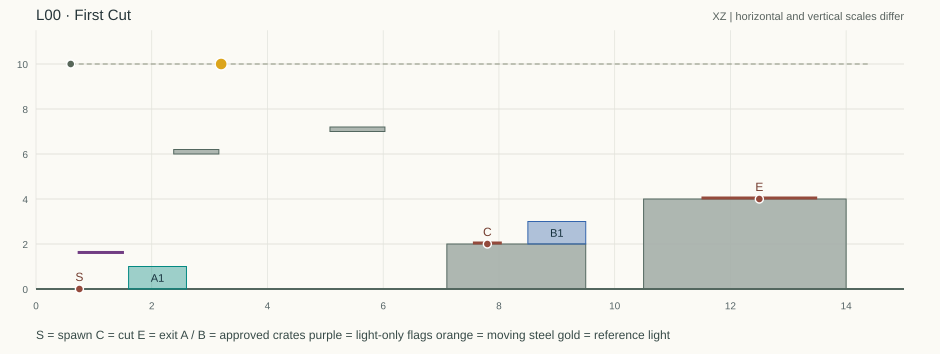
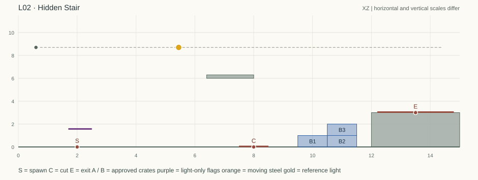
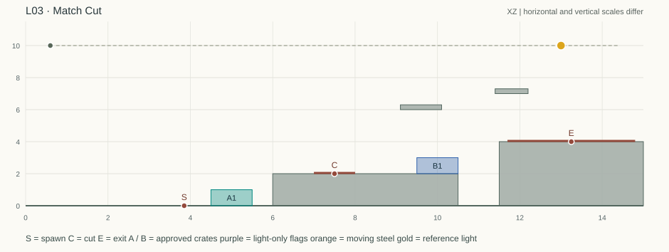
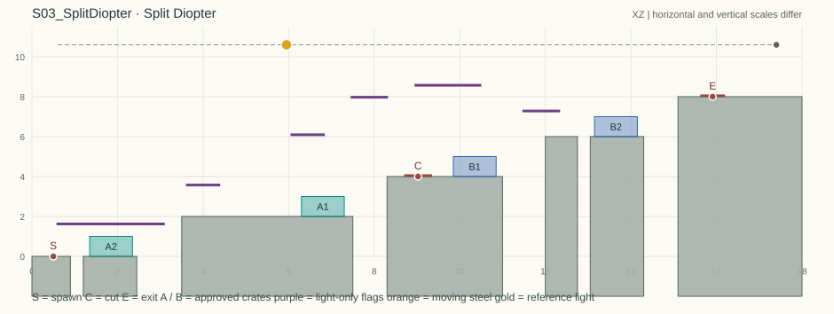
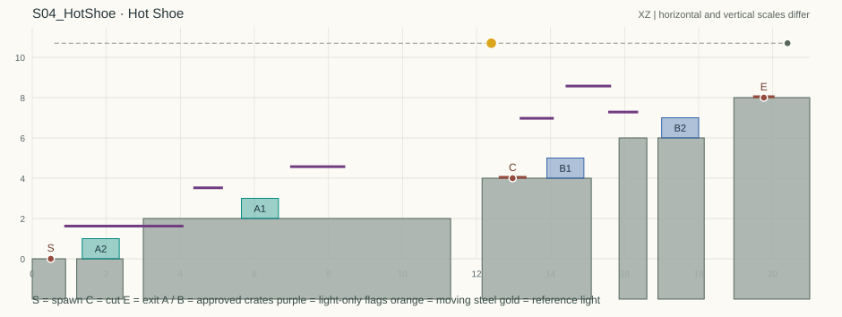
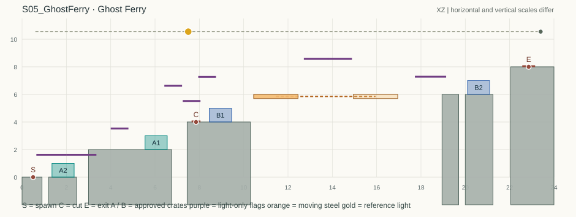

# Escape Unseen · v3 第一批关卡设计与程序核查

工程交付日期 2026-11-14。单位 B，1B=100cm。报告以地图 JSON、求解器输出及逐跳辅助检查为依据。地图可供白盒搭建；通关时间是设计预估，尚未取得这版的 UE 试玩记录。

| 场次与地图 | 玩家在这一关多做的判断 | 首通估计（分钟） | 可解点数下界–上界 / 总数 | 比例上界 |
|---|---|---:|---:|---:|
| L00 · First Cut | 教学：拖灯、推至粉笔线、剪掉见光箱 | 2–4 | 17–17 / 277 | 6.14% |
| L02 · Hidden Stair | 空 A；B 低箱给二层箱留出踏面 | 2–5 | 49–136 / 277 | 49.10% |
| L03 · Match Cut | 同一实体在两镜分别服务两层 | 3–5 | 30–49 / 277 | 17.69% |
| S03 · Split Diopter | 两镜共灯，四个分层箱位同时过审批 | 3–5 | 9–9 / 337 | 2.67% |
| S04 · Hot Shoe | 借光推箱，亮箱留在 A，剪入 B | 4–7 | 15–15 / 397 | 3.78% |
| S05 · Ghost Ferry | 剪上码头，借箱上横渡台，留出巡查后的船班 | 5–8 | 12–12 / 457 | 2.63% |

**怎样读这些数字。** 上界把候选箱位和移动能力放宽；当上界是 0，可以排除该策略。下界逐灯保存同时满足审批、路线、跳跃和巡视时间预算的构造；它至少有一条符合模型的走法。区间宽度取下界，难度比例、删机制和解法族数取上界。每个上界样点都有路线时，用相同数字表示两端。L02 使用三箱专用的包含关系证明。家族比较同镜同层对应箱的位置，不靠一串相邻摆法传递合并。

**白盒约定。** 固体和黑旗都遮光，黑旗无碰撞；箱和人不遮光。X 表示箱左缘，Z 是箱底；人物所有点均指脚底中心。箱边各外扩 0.005B，整箱均需入影；巡视每帧检查当前镜头全部箱、人物头 Z+1.20 和胸 Z+0.85。相机视野外的箱子同样接受审批和巡视判定。剪接只改道具快照，主角和巡逻时钟延续。看守缩回后随机 10–20s，最后 5s 报警，检查持续 1.5s。等候须在人箱可持续躲藏的实心踏面上。移动钢板 2×0.3B，按单程**平均**速度作正弦往返，两端各停 0.60s；与主角接触按游戏既有承载规则，切镜与 RETAKE 均不复相。全轨为 [0.60, 宽−0.60]，灯轨与设施/平台全扫掠体净距至少 0.30B。宽图表演时水平跟随。

**复跑。** ZIP 根目录含标准库 Python 脚本、每关输入、完整报告和坐标图。下例在解压后的目录运行，Python 3.10 或以上。

```sh
python level_solver.py levels/L00.json -o local_result.json --brief
python check_reference.py levels/L00.json
python check_carriers.py --scene S05 --output local_carrier_checks.json
```

`levels/` 和 `reports/` 用同一关卡编号对应。`intervals` 是宽松筛选，`constructive.intervals` 是路线证书；L02 对应字段为 `certified.intervals`。`reports/reference_arcs.json` 给出跳跃控制参数及净距。两批均附同一接口，脚本及同目录辅助模块应一并保留。`reports/carrier_checks.json` 另存每个可解灯位上、下船动作的连续时间包络和完整巡视周期调度检查。图中 S、C、E 分别为出生、剪点和出口；绿箱是 A，蓝箱是 B，紫线是无碰撞遮光旗；横纵绘图比例不同，实装按坐标表。

## L00 · First Cut｜先推半步，再剪走亮箱



**玩家要看懂的事**　把第一道粉笔线当作能等巡的停车位；第二道线只借来登台，赶在看守回来前剪掉亮箱。

场次 00。预计首通 2–4 分钟；参考动作 7–9 秒，首次试听另加一次巡逻。 房间宽 15B、高 11.5B，连续地板顶 Z=0，表演横向跟随。平台 0 个。

| 设施 | X 跨度（B） | Z 跨度（B） | 性质 |
|---|---:|---:|---|
| Middle Ledge | [7.10, 9.50] | [0.00, 2.00] | 实心、遮光 |
| Exit Ledge | [10.50, 14.00] | [0.00, 4.00] | 实心、遮光 |
| Lower Shade | [2.38, 3.16] | [6.00, 6.20] | 实心、遮光 |
| Upper Shade | [5.08, 6.03] | [7.00, 7.20] | 实心、遮光 |
| Entry Scrim | [0.72, 1.52] | [1.65, 1.69] | 黑旗，无碰撞、遮光 |

灯轨 X=[0.60,14.40]、Z=10.00，开局左端 X=0.60，参考 X=3.20；到最高设施的净距 2.80B。出生 (0.75, 0.00) 朝右，剪辑区 X=[7.55, 8.05]@2，出口 X=[11.50, 13.50]@4。A/B 名额 1/1，共享实体池 1。

| 镜头 | 编号 | 审批箱左下角（B） | 承托 |
|---|---|---|---|
| A | #01 | (1.60, 0.00) | 连续地板 |
| B | #01 | (8.50, 2.00) | Middle Ledge |

**参考表演。** 箱左缘先从 1.60 推至 1.90，角色站在 (1.60,0) 等看守完全缩回。向右再推 4.20B 到 X=6.10，耗时 2.80s；墙脚箱已经见光。退至 (5.45,0) 再起跳。上中台后走到 (7.85,2) 按 E，B 暗箱出现，两跳抵门。

| 起跳脚底 → 落点脚底（B） | 上升（B） | 未借边的水平余量（B） |
|---|---:|---:|
| (5.45, 0.00) → (6.58, 1.00) | 1.00 | 1.30 |
| (6.58, 1.00) → (7.65, 2.00) | 1.00 | 1.36 |
| (7.85, 2.00) → (9.02, 3.00) | 1.00 | 1.26 |
| (9.02, 3.00) → (10.95, 4.00) | 1.00 | 0.50 |

**阴影与露光反例。** A 初摆、第一线箱的外扩四角在 Lower Shade 下缘的投影分别为 [2.486,2.962]、[2.620,3.082]；B 箱在 Upper Shade 下缘的投影为 [5.184,5.904]。错灯 (3.90,10) 下，A 箱内点 (2.58,0.97) 的光线穿过 Lower Shade 底/顶高度时 X≈3.315/3.344，均在梁右，其余设施也未挡光。参考灯下墙脚箱内点 (6.52,0.98) 见光。

**主角与当前镜头所有箱子的巡视。** 人物从地面 X≈3.103 出影，经过推箱、起跳，到中台 X≈7.689 重新入影，连续 3.11s。B 箱顶最后一跳至出口连续约 1.00s。人箱共同等待区为入口 [0.75,1.29]@0、第一线 [1.34,1.60]@0、剪成 B 后 [7.72,8.00]@2、B 箱顶 [8.85,9.03]@3。第一线至剪走 A 箱预算 5.30s，因此应等巡完再出发。

**两条可请求提示。** ① `Nudge the crate to the chalk line. Wait there for the first patrol.`　② `Push to the wall, jump twice, and cut before the guard looks.`

**教程触发。** 加载时锁定左端作初始位置。先显示原手电说明，进入可拖动状态而灯仍未移动时显示 `Drag the lamp along the rail.`。第一次真实拖动后收起，接 `Press Enter to lock the light.`；禁止两条同时覆盖。首次真实预警显示 `Footsteps! Hide yourself and every crate.`。JSON 中的 `tutorial` 按事件顺序列出 16 条英文。

### 全轨复核

0.05B 灯轨采样共 277 点。区间均含两端。中点及最高物中心另外用实际坐标单点校验。

| 指标 | 本次结果 |
|---|---|
| 存在构造路线的灯位 | 17 点 · [3.05, 3.85]，占 6.14% |
| 宽松运动、审批上界 | 17 点 · [3.05, 3.85]，占 6.14% |
| 可连续停灯的实证宽度／候选区间中心距起端 | 0.80B ／ 2.85B |
| 库存少一只 | 0 点 |
| 禁主机制（不能切镜） | 0 点 |
| 0.50B 解法族上界 | ≤5 族（275 种候选 A/B 组合） |

旧关适用范围为 起点无解、必须拖灯；教程其余数值供比较。

| §4.3 尝试 | 结果 |
|---|---|
| ① 起始灯 X=0.60 | 无解 |
| ② 正中 X=7.50 | 无解 |
| ③ 最高遮挡中心正上方 | Upper Shade X=5.555（无解） |
| ④ 另一轨端 X=14.40 | 无解 |
| ⑤ 每镜所有箱子放在同一 X | 17 点 · [3.05, 3.85]；每镜一箱自动同柱 |
| ⑥ 省掉操作 | 不能切镜 0 点；不用推箱 0 点 |


## L02 · Hidden Stair｜给上箱留支撑，也给自己留第一级



**玩家要看懂的事**　低箱顶要露出一个能站脚的踏面，才能爬上旁边的二层箱。

场次 01。预计首通 2–5 分钟；参考动作 4.35 秒。 房间宽 15B、高 11.5B，连续地板顶 Z=0，表演横向跟随。平台 0 个。

| 设施 | X 跨度（B） | Z 跨度（B） | 性质 |
|---|---:|---:|---|
| Exit Ledge | [12.00, 15.00] | [0.00, 3.00] | 实心、遮光 |
| Beam | [6.40, 8.00] | [6.00, 6.30] | 实心、遮光 |
| Entry Flag | [1.70, 2.50] | [1.60, 1.64] | 黑旗，无碰撞、遮光 |

灯轨 X=[0.60,14.40]、Z=8.70，开局左端 X=0.60，参考 X=5.45；到最高设施的净距 2.40B。出生 (2.00, 0.00) 朝右，剪辑区 X=[7.50, 8.50]@0，出口 X=[12.20, 14.80]@3。A/B 名额 0/3，共享实体池 3。

| 镜头 | 编号 | 审批箱左下角（B） | 承托 |
|---|---|---|---|
| A | — | 空 | — |
| B | #01 | (9.50, 0.00) | 连续地板 |
| B | #02 | (10.50, 0.00) | 连续地板 |
| B | #03 | (10.50, 1.00) | B #02 |

**参考表演。** A 镜空场，从 (2,0) 走到 (8,0) 按 E。在 (8.7,0) 起跳，先落到 #01 的低踏面，再上 #03、门台。#02 全底支撑 #03。保留 v2 设施、箱位、出生和交互区，仅把全轨高度选为 8.70B，参考灯移至 X=5.45。

| 起跳脚底 → 落点脚底（B） | 上升（B） | 未借边的水平余量（B） |
|---|---:|---:|
| (8.70, 0.00) → (10.00, 1.00) | 1.00 | 1.13 |
| (10.00, 1.00) → (11.00, 2.00) | 1.00 | 1.43 |
| (11.00, 2.00) → (12.40, 3.00) | 1.00 | 1.03 |

**阴影与露光反例。** 在 Beam 下缘 Z=6，#01、#02、#03 全箱外扩后的投影分别为 [6.705,7.224]、[7.015,7.575]、[7.218,7.892]，均在 [6.4,8] 内。将灯放回左端 (0.60,8.70)，#01 内点 (9.51,0.50) 穿过梁底/顶高度时 X≈3.534/3.208，均在梁左；入口旗和出口台同样不挡该射线。

**主角与当前镜头所有箱子的巡视。** 按 v3 参考灯重算，A 从地面 X≈2.181 出影，跨过 (8,0) 的剪接，到 B 地面 X≈8.219 入影，1.76s。最后一跳从 (11.00,2.267) 出影，到 (12.4,3) 按 E 计 0.94s。入口的可等区间取 [1.48,2.17]@0，两级 B 踏面各取 [9.82,10.18]@1、[10.82,11.17]@2。A 的剪点在光中，不能在按键前后停留。

**两条可请求提示。** ① `Leave one low crate top free to stand on.`　② `Cut on the floor mark. Climb the low crate first.`

**三箱证明。** 出口脚底高 3B，空跳上升至多 1.30B。首次上门台前，角色无法从地面接触横梁或门台上的高箱。平推或跌落不能增加箱子高度，因此初始至少要有一个在地面箱上方获批的箱；若上箱跨放在两个齐平底箱上，二者阴影并集也完整覆盖同 X 的虚拟底箱。程序在每个灯位枚举所有这样的箱左缘，得出可能灯位上界，再以普通三跳和允许土狼时间的边缘起跳两种路线，检查实体侧面净空及整段≤8s，给出可解下界。最高横梁正上方 X=7.20 有一条作弊路线：低箱左缘 6.75，双层箱左缘 8.40，X=8.05 剪镜；从双层箱右缘走出 0.08s 再起跳可踩上门台，离窗至门不超过 4.56s。正中 X=7.50 仍未定。

### 全轨复核

0.05B 灯轨采样共 277 点。区间均含两端。中点及最高物中心另外用实际坐标单点校验。

| 指标 | 本次结果 |
|---|---|
| 存在构造路线的灯位 | 49 点 · [4.80, 7.20]，占 17.69% |
| 宽松运动、审批上界 | 136 点 · [4.35, 11.10]，占 49.10% |
| 可连续停灯的实证宽度／候选区间中心距起端 | 2.40B ／ 7.12B |
| 库存少一只 | 至多 136 点 · [4.35, 11.10]，是否能拆柱通关未定 |
| 禁主机制（不能切镜） | 0 点 |
| 0.50B 解法族上界 | 旧关未设族数门槛 |

仍待确认的灯位共 87 点，[4.35, 4.75]、[7.25, 11.10]。上表的比例门槛已将这些点全部按可能通关计算。

旧关适用范围为 起点无解、全轨通关比例 ≤50%。其余项目如实列出供对照。

| §4.3 尝试 | 结果 |
|---|---|
| ① 起始灯 X=0.60 | 无解 |
| ② 正中 X=7.50 | 未定 |
| ③ 最高遮挡中心正上方 | Beam X=7.200（有构造路线） |
| ④ 另一轨端 X=14.40 | 无解 |
| ⑤ 每镜所有箱子放在同一 X | 至多 136 点 · [4.35, 11.10]，动态拆柱未定 |
| ⑥ 省掉操作 | 无需推箱的三跳路线至少 49 点 · [4.80, 7.20]；不剪镜 0 点 |


## L03 · Match Cut｜一只箱接两道高差



**玩家要看懂的事**　镜头切换后主角留在原地，箱子却可以先到下一级台阶。

场次 02。预计首通 3–5 分钟；四跳及交互约 4–5 秒。 房间宽 15B、高 11.5B，连续地板顶 Z=0，表演横向跟随。平台 0 个。

| 设施 | X 跨度（B） | Z 跨度（B） | 性质 |
|---|---:|---:|---|
| Mid Ledge | [6.00, 10.50] | [0.00, 2.00] | 实心、遮光 |
| Exit Ledge | [11.50, 15.00] | [0.00, 4.00] | 实心、遮光 |
| Beam A | [9.10, 10.10] | [6.00, 6.30] | 实心、遮光 |
| Beam B | [11.40, 12.20] | [7.00, 7.30] | 实心、遮光 |

灯轨 X=[0.60,14.40]、Z=10.00，开局左端 X=0.60，参考 X=13.00；到最高设施的净距 2.70B。出生 (3.85, 0.00) 朝右，剪辑区 X=[7.00, 8.00]@2，出口 X=[11.70, 14.80]@4。A/B 名额 1/1，共享实体池 1。

| 镜头 | 编号 | 审批箱左下角（B） | 承托 |
|---|---|---|---|
| A | #01 | (4.50, 0.00) | 连续地板 |
| B | #01 | (9.50, 2.00) | Mid Ledge |

**参考表演。** 用已核查的新出生 (3.85,0) 直接跳上 A 箱。上中台后走到 (7.50,2) 按 E，走到 (8.70,2) 起跳，经 B 的同一只箱抵达 (11.85,4) 按 E。全程可以不推。

| 起跳脚底 → 落点脚底（B） | 上升（B） | 未借边的水平余量（B） |
|---|---:|---:|
| (3.85, 0.00) → (5.00, 1.00) | 1.00 | 1.28 |
| (5.00, 1.00) → (6.40, 2.00) | 1.00 | 1.03 |
| (8.70, 2.00) → (10.00, 3.00) | 1.00 | 1.13 |
| (10.00, 3.00) → (11.85, 4.00) | 1.00 | 0.58 |

**阴影与露光反例。** A 箱在 Beam A 下缘的全箱投影 [9.218,10.003]；B 箱在 Beam B 下缘的投影 [11.497,12.065]。错灯 (6,10) 下，B 箱内点 (10.0,2.8) 在 Beam B 底/顶的投影 X≈7.667/7.500，亦避开 Beam A 及实心台。

**主角与当前镜头所有箱子的巡视。** 首跳 0.56s；第二跳 0.49s；B 从中台 X≈7.808 出影到 (9.71,3.23) 入影约 0.74s；末跳短暂出影约 0.03s、进门前再出影约 0.42s。末跳中间的空中阴影不能停车，把整跳、落稳和按 E 并为 0.99s。可站稳过巡的位置为 A 地面 [3.75,4.15]@0、A 箱顶 [4.82,5.18]@1、中台 [6.32,7.80]@2、B 箱顶 [9.82,10.18]@3。

**两条可请求提示。** ① `Use the striped crate to reach the middle mark.`　② `After the cut, look for that same crate on the upper ledge.`

**右端的另一条路线。** 灯在 X=14.40 时仍能通关。A 箱左缘 4.50，B 箱左缘 7.50。等看守从暗出生点前完全缩回，先上中台，在 X=7.10 剪镜；角色在 B 箱左侧，能向右推 2.00B 到 X=9.50，再经箱顶入门。含落稳和按 E 的联合预算 5.13s。这是选择左端开局的实证理由。

### 全轨复核

0.05B 灯轨采样共 277 点。区间均含两端。中点及最高物中心另外用实际坐标单点校验。

| 指标 | 本次结果 |
|---|---|
| 存在构造路线的灯位 | 30 点 · [12.95, 14.40]，占 10.83% |
| 宽松运动、审批上界 | 49 点 · [12.00, 14.40]，占 17.69% |
| 可连续停灯的实证宽度／候选区间中心距起端 | 1.45B ／ 12.60B |
| 库存少一只 | 0 点 |
| 禁主机制（不能切镜） | 0 点 |
| 0.50B 解法族上界 | ≤24 族（1742 种候选 A/B 组合） |

仍待确认的灯位共 19 点，[12.00, 12.90]。上表的比例门槛已将这些点全部按可能通关计算。

旧关适用范围为 起点无解、全轨通关比例 ≤50%。其余项目如实列出供对照。

| §4.3 尝试 | 结果 |
|---|---|
| ① 起始灯 X=0.60 | 无解 |
| ② 正中 X=7.50 | 无解 |
| ③ 最高遮挡中心正上方 | Beam B X=11.800（无解） |
| ④ 另一轨端 X=14.40 | 有构造路线 |
| ⑤ 每镜所有箱子放在同一 X | 49 点 · [12.00, 14.40]；每镜一箱自动同柱 |
| ⑥ 省掉操作 | 不能切镜 0 点；不用推箱 37 点 · [12.60, 14.40] |


## S03 · Split Diopter



地图 `S03_SplitDiopter`。主机制为切镜重搭四级台阶。预计首次解出 3–5 分钟。

**啊哈时刻**　把两只箱从不同高度的前景剪到两个更高的踏座；灯须给四个落脚位同时留影。

近景与远景能否同时对焦，取决于两片不同高度的黑旗。先找分隔明显的四道 2B 台阶，再在摆景时观察近幕、远幕的影边。

**搭建**　内宽 18B，房高 11.5B。地面由下表各座体独立组成，无连续底板。坐标下界 −2B 表示实体延伸至舞台标高以下；落入沟中按现有跌落重演。相机横向跟随，切镜保持机位。灯轨 Z=10.6，X=[0.60, 17.40]，从右端加载；参考灯 (5.95, 10.6)。全轨与最高设施的竖直净距为 1.96B。

| 固定设施 | X 范围（B） | Z 范围（B） | 用途 |
|---|---|---|---|
| Crew Landing | [0, 0.9] | [-2, 0] | 实心，可踩、挡光 |
| Low Prop Seat | [1.2, 2.45] | [-2, 0] | 实心，可踩、挡光 |
| Near Riser | [3.5, 7.5] | [-2, 2] | 实心，可踩、挡光 |
| Splice Block | [8.3, 11] | [-2, 4] | 实心，可踩、挡光 |
| Arrival Shoe | [12, 12.75] | [-2, 6] | 实心，可踩、挡光 |
| High Prop Seat | [13.05, 14.3] | [-2, 6] | 实心，可踩、挡光 |
| Screen Door | [15.1, 18] | [-2, 8] | 实心，可踩、挡光 |
| Far Mask | [7.449, 8.321] | [8, 8.04] | 黑旗，无碰撞、挡光 |
| Entry Brow | [3.6, 4.4] | [3.6, 3.64] | 黑旗，无碰撞、挡光 |
| Entrance Scrim 1 | [0.575, 1.845] | [1.65, 1.69] | 黑旗，无碰撞、挡光 |
| Entrance Scrim 2 | [1.835, 3.105] | [1.65, 1.69] | 黑旗，无碰撞、挡光 |
| Rim Scrim 1 | [8.94, 10.503] | [8.6, 8.64] | 黑旗，无碰撞、挡光 |
| Arrival Brow 1 | [11.465, 12.345] | [7.31, 7.35] | 黑旗，无碰撞、挡光 |
| Near Mask | [6.045, 6.845] | [6.12, 6.16] | 黑旗，无碰撞、挡光 |

**交互区**　出生脚底 (0.5, 0)，面朝右。标记 X=[8.7, 9.35]、Z=4，仅一次 A→B；出口 X=[15.62, 16.2]、Z=8，站稳后按 E。两镜各用 #01、#02，共享 2 个实体。看守窗口为背景演出，相机跟随时保留当前画面上方的预警。

本关无移动平台。

| 镜头 | 道具 | 审批矩形 X × Z | 完整固定支撑 |
|---|---|---|---|
| A | #01 | [6.3, 7.3] × [2, 3] | Near Riser |
| A | #02 | [1.35, 2.35] × [0, 1] | Low Prop Seat |
| B | #01 | [9.85, 10.85] × [4, 5] | Splice Block |
| B | #02 | [13.15, 14.15] × [6, 7] | High Prop Seat |

**静态阴影**　外扩每边 0.005B 后，在旗底切平面计算通过箱面角点的光线交点 X。相邻同高的旗边重叠，连续黑布能挡住跨越两片布的中间射线。以下四处以固定遮挡独立成立。

| 审批箱 | 遮挡及底 Z | 光线交点 X／遮布 X |
|---|---|---|
| A #01 | Near Mask @ 6.12 | [6.13, 6.749] ⊆ [6.045, 6.845] |
| A #02 | Entrance Scrim @ 1.65 | [1.655, 2.916] ⊆ [0.575, 3.105] |
| B #01 | Far Mask @ 8 | [7.483, 8.229] ⊆ [7.449, 8.321] |
| B #02 | Rim Scrim @ 8.6 | 底边交点 [9.075, 10.515]，连同厚 0.04B 的侧边挡住完整箱面 |

**露光反例**　灯停右端 (17.4, 10.6)，参考 A #01 的内部点 (6.32, 2.98) 通向灯的射线避开所有固定设施。这只箱在该布景下审批失败。

参考灯下，按 .05B 网格枚举，各必经支撑层允许的**箱左缘**为 A #01 [6.15, 6.45]，A #02 [1.2, 1.45]，B #01 [9.8, 10]，B #02 [13.05, 13.25]。

**表演走法**　A 从出生连上两级，抵达低台后走到 X=5.48，借 #01 上剪辑台，在 X=9.02 按 E。B 的 #01、#02 分守上下两层，连续交替踏箱和实台，进门按 E。

| 镜头 | 起跳脚底 → 落地脚底 | 上升（B） | 水平余量（B） |
|---|---|---:|---:|
| A | (0.5, 0) → (1.85, 1) | 1.00 | 1.08 |
| A | (1.85, 1) → (3.85, 2) | 1.00 | 0.43 |
| A | (5.48, 2) → (6.8, 3) | 1.00 | 1.11 |
| A | (6.8, 3) → (8.67, 4) | 1.00 | 0.56 |
| B | (9.02, 4) → (10.35, 5) | 1.00 | 1.10 |
| B | (10.35, 5) → (12.4, 6) | 1.00 | 0.38 |
| B | (12.4, 6) → (13.6, 7) | 1.00 | 1.23 |
| B | (13.6, 7) → (15.5, 8) | 1.00 | 0.53 |

**人物与道具共同等巡的位置**　表内均已检验灯照到头、胸的两条光线。X 区间是参考路线所用的保守子段，脚下必须是相应踏面。

| 镜头／地点 | X 范围 @ 脚底 Z | 遮挡 | 到下一处可等位或 E 门（含操作） |
|---|---|---|---:|
| A · 出生踏台 | [0.38, 0.62] @ 0 | Entrance Scrim 1 | ≤1.64s |
| A · 低台入口帽檐 | [3.98, 4.22] @ 2 | Entry Brow | ≤1.22s |
| A · 低台箱顶 | [6.68, 6.92] @ 3 | Near Mask | ≤2.59s |
| B · 东到岸帽檐 | [12.28, 12.52] @ 6 | Rim Scrim 1, Arrival Brow 1 | ≤1.89s |

**逐段人物露光**　从出生至门按顺序为 1.18s, 0.70s, 0.90s, 0.61s, 1.58s。第三段跨越剪辑。连续表演约 6.65s。

**空场与捷径**　从出生到标记须过 0→2→4，从标记到门须过 4→6→8。两箱各给一道 2B 高差提供中间踏面。求解采用的宽松跳高 1.30B，平推与跌落都无法把低箱搬上另一固定层。双箱同列会失去另一层的踏步。一镜从出生到门需支援四个高度，A 镜两箱不足。

**渐进提示**

1. `Follow the near mask, then check which step the far mask covers.`
2. `Build on the low pier in A. Reuse that crate above in B.`

### 全轨复核

0.05B 灯轨采样共 337 点。区间均含两端。中点及最高物中心另外用实际坐标单点校验。

| 指标 | 本次结果 |
|---|---|
| 存在构造路线的灯位 | 9 点 · [5.80, 6.20]，占 2.67% |
| 宽松运动、审批上界 | 9 点 · [5.80, 6.20]，占 2.67% |
| 可连续停灯的实证宽度／候选区间中心距起端 | 0.40B ／ 11.40B |
| 库存少一只 | 0 点 |
| 禁主机制（不能切镜） | 0 点 |
| 0.50B 解法族上界 | ≤2 族（2814 种候选 A/B 组合） |

| §4.3 尝试 | 结果 |
|---|---|
| ① 起始灯 X=17.40 | 无解 |
| ② 正中 X=9.00 | 无解 |
| ③ 最高遮挡中心正上方 | Rim Scrim 1 X=9.722（无解） |
| ④ 另一轨端 X=0.60 | 无解 |
| ⑤ 每镜所有箱子放在同一 X | 0 点 |
| ⑥ 省掉操作 | 不能切镜 0 点；不用推箱 9 点 · [5.80, 6.20] |


## S04 · Hot Shoe



地图 `S04_HotShoe`。主机制为将已获批的箱推进光里。预计首次解出 4–7 分钟。

**啊哈时刻**　审批位离缺口太远，踏步位一定见光；先把箱推进亮处，借完赶在巡视前剪走。

长推轨左端有可见的窄影，右端留下借箱踏步的粉笔线。入口和高岸各需要另一只箱，不能用额外库存绕过推行。

**搭建**　内宽 21B，房高 11.5B。地面由下表各座体独立组成，无连续底板。坐标下界 −2B 表示实体延伸至舞台标高以下；落入沟中按现有跌落重演。相机横向跟随，切镜保持机位。灯轨 Z=10.7，X=[0.60, 20.40]，从右端加载；参考灯 (12.4, 10.7)。全轨与最高设施的竖直净距为 2.06B。

| 固定设施 | X 范围（B） | Z 范围（B） | 用途 |
|---|---|---|---|
| Crew Landing | [0, 0.9] | [-2, 0] | 实心，可踩、挡光 |
| Low Prop Seat | [1.2, 2.45] | [-2, 0] | 实心，可踩、挡光 |
| Truck Run | [3, 11.3] | [-2, 2] | 实心，可踩、挡光 |
| Cut Pier | [12.15, 15.1] | [-2, 4] | 实心，可踩、挡光 |
| Arrival Shoe | [15.85, 16.6] | [-2, 6] | 实心，可踩、挡光 |
| High Prop Seat | [16.9, 18.15] | [-2, 6] | 实心，可踩、挡光 |
| Screen Door | [18.95, 21] | [-2, 8] | 实心，可踩、挡光 |
| Low Cutter | [6.965, 8.454] | [4.6, 4.64] | 黑旗，无碰撞、挡光 |
| High Cutter | [13.165, 14.087] | [7, 7.04] | 黑旗，无碰撞、挡光 |
| Crew Hood | [4.35, 5.15] | [3.55, 3.59] | 黑旗，无碰撞、挡光 |
| Entrance Scrim 1 | [0.865, 1.945] | [1.65, 1.69] | 黑旗，无碰撞、挡光 |
| Entrance Scrim 2 | [1.935, 3.015] | [1.65, 1.69] | 黑旗，无碰撞、挡光 |
| Entrance Scrim 3 | [3.005, 4.085] | [1.65, 1.69] | 黑旗，无碰撞、挡光 |
| Rim Scrim 1 | [14.405, 15.635] | [8.6, 8.64] | 黑旗，无碰撞、挡光 |
| Arrival Brow 1 | [15.555, 16.365] | [7.31, 7.35] | 黑旗，无碰撞、挡光 |

**交互区**　出生脚底 (0.5, 0)，面朝右。标记 X=[12.6, 13.35]、Z=4，仅一次 A→B；出口 X=[19.47, 20.05]、Z=8，站稳后按 E。两镜各用 #01、#02，共享 2 个实体。看守窗口为背景演出，相机跟随时保留当前画面上方的预警。

本关无移动平台。

| 镜头 | 道具 | 审批矩形 X × Z | 完整固定支撑 |
|---|---|---|---|
| A | #01 | [5.65, 6.65] × [2, 3] | Truck Run |
| A | #02 | [1.35, 2.35] × [0, 1] | Low Prop Seat |
| B | #01 | [13.9, 14.9] × [4, 5] | Cut Pier |
| B | #02 | [17, 18] × [6, 7] | High Prop Seat |

**静态阴影**　外扩每边 0.005B 后，在旗底切平面计算通过箱面角点的光线交点 X。相邻同高的旗边重叠，连续黑布能挡住跨越两片布的中间射线。以下四处以固定遮挡独立成立。

| 审批箱 | 遮挡及底 Z | 光线交点 X／遮布 X |
|---|---|---|
| A #01 | Low Cutter @ 4.6 | [7.045, 8.374] ⊆ [6.965, 8.454] |
| A #02 | Entrance Scrim @ 1.65 | [2.08, 3.908] ⊆ [0.865, 4.085] |
| B #01 | High Cutter @ 7 | [13.225, 14.027] ⊆ [13.165, 14.087] |
| B #02 | Rim Scrim @ 8.6 | [14.451, 15.586] ⊆ [14.405, 15.635] |

**露光反例**　灯停右端 (20.4, 10.7)，参考 A #01 的内部点 (5.67, 2.02) 通向灯的射线避开所有固定设施。这只箱在该布景下审批失败。

参考灯下，按 .05B 网格枚举，各必经支撑层允许的**箱左缘**为 A #01 [5.55, 5.75]，A #02 [1.2, 1.45]，B #01 [13.8, 14]，B #02 [16.9, 17.15]。

**表演走法**　A 起步用 #02 上推轨，走到 X=5.35 贴 #01 左侧。向右推 4.55B，#01 箱左从 5.65 到 10.20，用时 3.04s。退至 X=9.55 起跳，上剪台后在 X=13.02 按 E，A 的亮箱随切镜消失。B 分别用 #01 登岸、#02 登门，进门按 E。

| 镜头 | 起跳脚底 → 落地脚底 | 上升（B） | 水平余量（B） |
|---|---|---:|---:|
| A | (0.5, 0) → (1.85, 1) | 1.00 | 1.08 |
| A | (1.85, 1) → (3.35, 2) | 1.00 | 0.93 |
| A | (9.55, 2) → (10.65, 3) | 1.00 | 1.33 |
| A | (10.65, 3) → (12.52, 4) | 1.00 | 0.56 |
| B | (13.02, 4) → (14.4, 5) | 1.00 | 1.05 |
| B | (14.4, 5) → (16.25, 6) | 1.00 | 0.58 |
| B | (16.25, 6) → (17.45, 7) | 1.00 | 1.23 |
| B | (17.45, 7) → (19.35, 8) | 1.00 | 0.53 |

**人物与道具共同等巡的位置**　表内均已检验灯照到头、胸的两条光线。X 区间是参考路线所用的保守子段，脚下必须是相应踏面。

| 镜头／地点 | X 范围 @ 脚底 Z | 遮挡 | 到下一处可等位或 E 门（含操作） |
|---|---|---|---:|
| A · 出生踏台 | [0.38, 0.62] @ 0 | Entrance Scrim 1 | ≤1.84s |
| A · 低台入口帽檐 | [4.28, 4.43] @ 2 | Crew Hood | ≤5.99s |
| B · 高台箱顶 | [14.28, 14.46] @ 5 | High Cutter | ≤0.87s |
| B · 东到岸帽檐 | [16.13, 16.37] @ 6 | Rim Scrim 1, Arrival Brow 1 | ≤1.89s |

**逐段人物露光**　从出生至门按顺序为 1.53s, 0.46s, 3.87s, 0.45s, 1.48s。推箱、登台、剪走旧箱的连续人物暴露最长 3.87s。A 推后箱比人物更早露光，故从低台入口帽檐等看守缩回再出发；到 B 箱顶联合预算 5.99s。连续表演约 9.90s。

**空场与捷径**　从出生到标记须过 0→2→4，从标记到门须过 4→6→8。两箱各给一道 2B 高差提供中间踏面。求解采用的宽松跳高 1.30B，平推与跌落都无法把低箱搬上另一固定层。双箱同列会失去另一层的踏步。全轨联合可行灯位内，A 的 #01 最右起位左缘 X=5.90，右沿 X=6.90，距剪台左沿 12.15 尚有 5.25B；+1B 跳就算加土狼时间和两侧胶囊也只能跨 3.426B。禁推必断。

**渐进提示**

1. `The safe place to shoot this crate is not the place to climb it.`
2. `Push right toward the gap. Climb, cut, and let the other shot hide it.`

### 全轨复核

0.05B 灯轨采样共 397 点。区间均含两端。中点及最高物中心另外用实际坐标单点校验。

| 指标 | 本次结果 |
|---|---|
| 存在构造路线的灯位 | 15 点 · [12.05, 12.75]，占 3.78% |
| 宽松运动、审批上界 | 15 点 · [12.05, 12.75]，占 3.78% |
| 可连续停灯的实证宽度／候选区间中心距起端 | 0.70B ／ 8.00B |
| 库存少一只 | 0 点 |
| 禁主机制（不能推箱） | 0 点 |
| 0.50B 解法族上界 | ≤2 族（2310 种候选 A/B 组合） |

| §4.3 尝试 | 结果 |
|---|---|
| ① 起始灯 X=20.40 | 无解 |
| ② 正中 X=10.50 | 无解 |
| ③ 最高遮挡中心正上方 | Rim Scrim 1 X=15.020（无解） |
| ④ 另一轨端 X=0.60 | 无解 |
| ⑤ 每镜所有箱子放在同一 X | 0 点 |
| ⑥ 省掉操作 | 不用推箱 0 点 |


## S05 · Ghost Ferry



地图 `S05_GhostFerry`。主机制为必乘的横移渡台。预计首次解出 5–8 分钟。

**啊哈时刻**　把箱从低入口剪到上船台和东岸；等人、箱、船三者都就位，才从候船箱上起跳。

同一条移动钢板既是交通工具，也会遮挡来自左上的灯。钢板带着影子越过码头边缘；用固定幕给箱遮光，船开走后它仍能过巡。

**搭建**　内宽 24B，房高 11.5B。地面由下表各座体独立组成，无连续底板。坐标下界 −2B 表示实体延伸至舞台标高以下；落入沟中按现有跌落重演。相机横向跟随，切镜保持机位。灯轨 Z=10.55，X=[0.60, 23.40]，从右端加载；参考灯 (7.5, 10.55)。全轨与最高设施的竖直净距为 1.91B。

| 固定设施 | X 范围（B） | Z 范围（B） | 用途 |
|---|---|---|---|
| Crew Landing | [0, 0.9] | [-2, 0] | 实心，可踩、挡光 |
| Low Prop Seat | [1.2, 2.45] | [-2, 0] | 实心，可踩、挡光 |
| Near Podium | [3, 6.75] | [-2, 2] | 实心，可踩、挡光 |
| Slate Pier | [7.45, 10.3] | [-2, 4] | 实心，可踩、挡光 |
| Arrival Shoe | [18.95, 19.7] | [-2, 6] | 实心，可踩、挡光 |
| High Prop Seat | [20, 21.25] | [-2, 6] | 实心，可踩、挡光 |
| Screen Door | [22.05, 24] | [-2, 8] | 实心，可踩、挡光 |
| Wing Mask | [6.42, 7.22] | [6.65, 6.69] | 黑旗，无碰撞、挡光 |
| Boarding Mask | [7.95, 8.75] | [7.3, 7.34] | 黑旗，无碰撞、挡光 |
| Crew Hood | [4, 4.8] | [3.55, 3.59] | 黑旗，无碰撞、挡光 |
| Waiting Screen | [7.25, 8.05] | [5.55, 5.59] | 黑旗，无碰撞、挡光 |
| Entrance Scrim 1 | [0.645, 2.005] | [1.65, 1.69] | 黑旗，无碰撞、挡光 |
| Entrance Scrim 2 | [1.995, 3.355] | [1.65, 1.69] | 黑旗，无碰撞、挡光 |
| Rim Scrim 1 | [12.715, 13.805] | [8.6, 8.64] | 黑旗，无碰撞、挡光 |
| Rim Scrim 2 | [13.795, 14.885] | [8.6, 8.64] | 黑旗，无碰撞、挡光 |
| Arrival Brow 1 | [17.725, 19.135] | [7.31, 7.35] | 黑旗，无碰撞、挡光 |

**交互区**　出生脚底 (0.5, 0)，面朝右。标记 X=[7.65, 8.05]、Z=4，仅一次 A→B；出口 X=[22.57, 23.15]、Z=8，站稳后按 E。两镜各用 #01、#02，共享 2 个实体。看守窗口为背景演出，相机跟随时保留当前画面上方的预警。

**Camera Dolly**　实心 2×0.3B，轴 X，起点中心 (11.45, 5.85)，向东 4.50B，单程平均 1.50B/s，初相 0.35。扫掠 X=[10.45, 16.95]、Z=[5.70, 6.00]；两端各停 0.6s。审批分别检两端，钢板扫区禁摆箱，回放与切镜均保持相位。

| 镜头 | 道具 | 审批矩形 X × Z | 完整固定支撑 |
|---|---|---|---|
| A | #01 | [5.55, 6.55] × [2, 3] | Near Podium |
| A | #02 | [1.35, 2.35] × [0, 1] | Low Prop Seat |
| B | #01 | [8.45, 9.45] × [4, 5] | Slate Pier |
| B | #02 | [20.1, 21.1] × [6, 7] | High Prop Seat |

**静态阴影**　外扩每边 0.005B 后，在旗底切平面计算通过箱面角点的光线交点 X。相邻同高的旗边重叠，连续黑布能挡住跨越两片布的中间射线。以下四处以固定遮挡独立成立。

| 审批箱 | 遮挡及底 Z | 光线交点 X／遮布 X |
|---|---|---|
| A #01 | Wing Mask @ 6.65 | [6.489, 7.069] ⊆ [6.42, 7.22] |
| A #02 | Entrance Scrim @ 1.65 | [1.761, 3.162] ⊆ [0.645, 3.355] |
| B #01 | Boarding Mask @ 7.3 | [7.969, 8.646] ⊆ [7.95, 8.75] |
| B #02 | Rim Scrim @ 8.6 | 底边交点 [12.892, 14.984]，连同厚 0.04B 的侧边挡住完整箱面 |

**露光反例**　灯停右端 (23.4, 10.55)，参考 B #01 的内部点 (9.43, 4.02) 通向灯的射线避开所有固定设施与钢板两个端点。这只箱在该布景下审批失败。

参考灯下，按 .05B 网格枚举，各必经支撑层允许的**箱左缘**为 A #01 [5.4, 5.75]，A #02 [1.2, 1.45]，B #01 [8.45, 8.65]，B #02 [20, 20.2]。

**表演走法**　A 用 #02 登低台、#01 登西码头。站 X=7.87 剪 B，用 #01 登候船箱，走到 X=9.10 等西端停靠。西端 0.60s 停驻的前 0.40s 内起跳，落点 X=10.99；上船后走到船中心右侧 +0.50B。东端停驻，从 X=16.45 起跳到东岸，随后用 #02 登门。

| 镜头 | 起跳脚底 → 落地脚底 | 上升（B） | 水平余量（B） |
|---|---|---:|---:|
| A | (0.5, 0) → (1.85, 1) | 1.00 | 1.08 |
| A | (1.85, 1) → (3.35, 2) | 1.00 | 0.93 |
| A | (4.62, 2) → (6.03, 3) | 1.00 | 1.02 |
| A | (6.03, 3) → (7.8, 4) | 1.00 | 0.66 |
| B | (7.87, 4) → (8.95, 5) | 1.00 | 1.35 |
| B | (9.1, 5) → (10.99, 6) | 1.00 | 0.54 |
| B | (16.45, 6) → (19.35, 6) | 0.00 | 0.35 |
| B | (19.35, 6) → (20.55, 7) | 1.00 | 1.23 |
| B | (20.55, 7) → (22.45, 8) | 1.00 | 0.53 |

**人物与道具共同等巡的位置**　表内均已检验灯照到头、胸的两条光线。X 区间是参考路线所用的保守子段，脚下必须是相应踏面。

| 镜头／地点 | X 范围 @ 脚底 Z | 遮挡 | 到下一处可等位或 E 门（含操作） |
|---|---|---|---:|
| A · 出生踏台 | [0.38, 0.62] @ 0 | Entrance Scrim 1 | ≤1.80s |
| A · 低台入口帽檐 | [4.13, 4.37] @ 2 | Crew Hood | ≤0.96s |
| A · 低台箱顶 | [5.91, 6.15] @ 3 | Wing Mask | ≤1.11s |
| B · 西码头剪点 | [7.75, 7.99] @ 4 | Waiting Screen | ≤0.91s |
| B · 西端候船箱顶 | [8.98, 9.18] @ 5 | Boarding Mask | ≤4.85s |
| B · 东到岸帽檐 | [19.23, 19.47] @ 6 | Arrival Brow 1 | ≤1.89s |

**逐段人物露光**　从出生至门按顺序为 1.48s, 0.07s, 0.47s, 0.04s, 0.23s, 4.85s, 1.65s。其中 4.85s 按在船上的全程都见光计算；摆船产生的额外荫蔽无需依赖。实际首通路线应另计在西码头等候的时间。

**候船与巡视**　西端停靠每 7.20s 重现。登船跳与西端的 0.60s 停驻并行。最晚起跳时落地前钢板仅东移约 0.20B，落点距西沿仍有约 0.34B。全程按西停 0.60、单程航行 3.00、东岸跳 0.813、站稳操作 0.437，共 4.85s 到达固定暗位。西端到站、看守缩回且尚无预警就出发，全程短于 5.00s。若已预警或正在检查，就留在箱顶。一个 5s 预警加 1.5s 检查最多覆盖一次西端到站，两次检查起点至少相隔 11.5s。连续三次到站相距 14.4s；若三个都落在危险段，三个危险段的首尾起点最少相距 23s，而最多只能相距 14.4+6.5=20.9s。因此至多等三次靠西便有一个无需赌相位的起跳时机。

**空场与捷径**　从出生到标记须过 0→2→4，从标记到门须过 4→6→8。两箱各给一道 2B 高差提供中间踏面。求解采用的宽松跳高 1.30B，平推与跌落都无法把低箱搬上另一固定层。双箱同列会失去另一层的踏步。删车后西码头右沿 10.30 到东到岸左沿 18.95 净空 8.65B，不可能靠两只箱补过河。空场人从 Z=4 单跳够不到 Z=6 船顶。

**渐进提示**

1. `An empty berth cannot take you across this soundstage.`
2. `Cut upon the pier. Board the steel ferry from the upper crate.`

### 全轨复核

0.05B 灯轨采样共 457 点。区间均含两端。中点及最高物中心另外用实际坐标单点校验。

| 指标 | 本次结果 |
|---|---|
| 存在构造路线的灯位 | 12 点 · [7.15, 7.70]，占 2.63% |
| 宽松运动、审批上界 | 12 点 · [7.15, 7.70]，占 2.63% |
| 可连续停灯的实证宽度／候选区间中心距起端 | 0.55B ／ 15.97B |
| 库存少一只 | 0 点 |
| 禁主机制（移除指定实物平台） | 0 点 |
| 0.50B 解法族上界 | ≤2 族（2610 种候选 A/B 组合） |

| §4.3 尝试 | 结果 |
|---|---|
| ① 起始灯 X=23.40 | 无解 |
| ② 正中 X=12.00 | 无解 |
| ③ 最高遮挡中心正上方 | Rim Scrim 1 X=13.260（无解）、Rim Scrim 2 X=14.340（无解） |
| ④ 另一轨端 X=0.60 | 无解 |
| ⑤ 每镜所有箱子放在同一 X | 0 点 |
| ⑥ 省掉操作 | 不坐任何移动平台 0 点 |

## 复核范围

几何扫描使用灯 X 与承托面箱左缘的 0.05B 网格，列举静置、合法叠箱、相邻底箱跨承托以及库存能为空的情况。静态审批同时测试所有平台端点组合；表演中的移动平台另外计入路程、停靠与等待。求解运动上限取上升 1.30B、土狼 0.10s 和两端贴边。参考路线以中心坐标和实际重力验算，单跳上升 ≤1.00B，水平余量 ≥0.30B。宽松路径会保留部分实际上不能连续执行的动作；各关的实际路线证书单列。共用可走面不会把箱子从低层抬上高层，未对剪点附近凭空增加禁搭区。

平台时钟以关卡加载为零，端点停留和搬运日程写在每关正文。路线证书检查固定实体及当前箱子、停等地点和全员联合时间；移动接触、Chaos 摩擦、帧率与交互输入仍需在工程中按同坐标复现。平台模型使用世界坐标起跳速度，不叠加平台瞬时速度。地图变更后应重新运行求解；每只被推到光里的箱子要在下一次巡视前移回阴影或剪走；线路时长按指定起跳点、落稳、推速和按键预算计算。若改动移动平台的行程、实际时钟或推箱速度，相应重计 JSON 中的巡逻段和行动时长。旧 L02 的包含关系证明对几何拓扑有显式前提，拓扑不匹配会退出。
