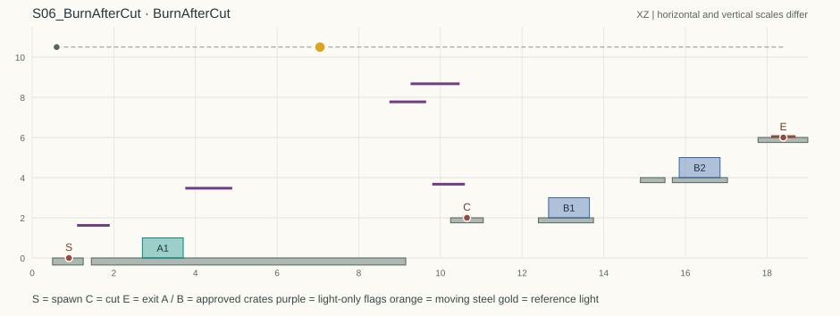
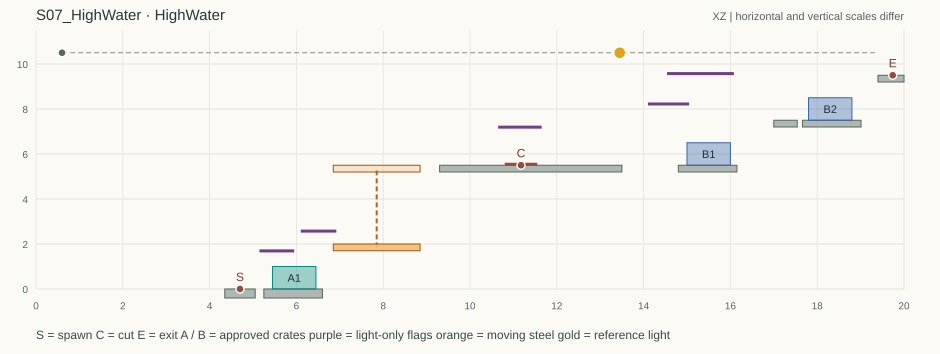
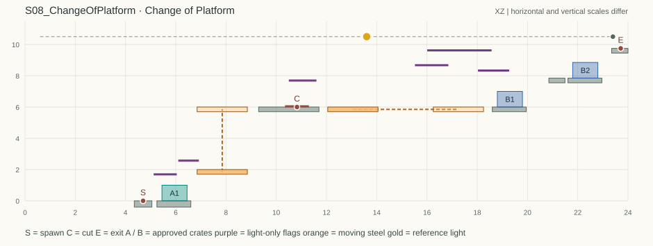

# Escape Unseen · v3 第二批关卡设计与程序核查

工程交付日期 2026-11-14。单位 B，1B=100cm。报告以地图 JSON、求解器输出及逐跳辅助检查为依据。地图可供白盒搭建；通关时间是设计预估，尚未取得这版的 UE 试玩记录。

| 场次与地图 | 玩家在这一关多做的判断 | 首通估计（分钟） | 可解点数下界–上界 / 总数 | 比例上界 |
|---|---|---:|---:|---:|
| S06 · BurnAfterCut | 巡视与剪接联动，推亮 A 箱后必须赶到剪点 | 7–10 | 13–13 / 357 | 3.64% |
| S07 · HighWater | 3.50B 升降与两个分层门阶 | 9–13 | 17–17 / 377 | 4.51% |
| S08 · Change of Platform | 4.00B 升降接横渡，异相双台与双层出口 | 12–17 | 17–17 / 457 | 3.72% |

**怎样读这些数字。** 上界把候选箱位和移动能力放宽；当上界是 0，可以排除该策略。下界逐灯保存同时满足审批、路线、跳跃和巡视时间预算的构造；它至少有一条符合模型的走法。区间宽度取下界，难度比例、删机制和解法族数取上界。每个上界样点都有路线时，用相同数字表示两端。L02 使用三箱专用的包含关系证明。家族比较同镜同层对应箱的位置，不靠一串相邻摆法传递合并。

**白盒约定。** 固体和黑旗都遮光，黑旗无碰撞；箱和人不遮光。X 表示箱左缘，Z 是箱底；人物所有点均指脚底中心。箱边各外扩 0.005B，整箱均需入影；巡视每帧检查当前镜头全部箱、人物头 Z+1.20 和胸 Z+0.85。相机视野外的箱子同样接受审批和巡视判定。剪接只改道具快照，主角和巡逻时钟延续。看守缩回后随机 10–20s，最后 5s 报警，检查持续 1.5s。等候须在人箱可持续躲藏的实心踏面上。移动钢板 2×0.3B，按单程**平均**速度作正弦往返，两端各停 0.60s；与主角接触按游戏既有承载规则，切镜与 RETAKE 均不复相。全轨为 [0.60, 宽−0.60]，灯轨与设施/平台全扫掠体净距至少 0.30B。宽图表演时水平跟随。

**复跑。** ZIP 根目录含标准库 Python 脚本、每关输入、完整报告和坐标图。下例在解压后的目录运行，Python 3.10 或以上。

```sh
python level_solver.py levels/S06_BurnAfterCut.json -o local_result.json --brief
python check_reference.py levels/S06_BurnAfterCut.json
python check_carriers.py --scene S07 --scene S08 --output local_carrier_checks.json
```

`levels/` 和 `reports/` 用同一关卡编号对应。`intervals` 是宽松筛选，`constructive.intervals` 是路线证书；L02 对应字段为 `certified.intervals`。`reports/reference_arcs.json` 给出跳跃控制参数及净距。两批均附同一接口，脚本及同目录辅助模块应一并保留。`reports/carrier_checks.json` 另存每个可解灯位上、下船动作的连续时间包络和完整巡视周期调度检查。图中 S、C、E 分别为出生、剪点和出口；绿箱是 A，蓝箱是 B，紫线是无碰撞遮光旗；横纵绘图比例不同，实装按坐标表。

## S06 · Burn After Cut｜借光后剪



**地图** `S06_BurnAfterCut`。**主机制** 表演中必推；剪接结束 A 箱的持续露光。**预计首通** 7–10 分钟。

**啊哈时刻。** 把已批的箱子推入灯下，登上剪标就让两只暗箱接班，赶在看守回来前抹掉亮箱。

### 搭建数据

内宽 19B，房高 11.5B。仅表中实心构件可以落脚；板下留空，落出演区重拍。表演开启横向跟随，相机在两侧内墙夹止，剪接保持位置。灯轨 Z=10.5, X=[0.60,18.40]，从左端 X=0.60 开始；参考灯 X=7.05。

| 固定构件 | X 范围 B | Z 范围 B | 碰撞与挡光 |
|---|---:|---:|---|
| DollyLane | [1.45, 9.15] | [-0.35, 0] | 可踩，挡光 |
| TapeDock | [10.25, 11.05] | [1.75, 2] | 可踩，挡光 |
| WestStep | [12.4, 13.75] | [1.75, 2] | 可踩，挡光 |
| ThresholdLip | [14.9, 15.5] | [3.75, 4] | 可踩，挡光 |
| EntryStool | [0.5, 1.25] | [-0.35, 0] | 可踩，挡光 |
| SecondKey | [15.68, 17.03] | [3.75, 4] | 可踩，挡光 |
| Door | [17.78, 19] | [5.75, 6] | 可踩，挡光 |
| LoadingLid | [3.75, 4.9] | [3.5, 3.54] | 无碰撞，挡光 |
| EastLid | [8.75, 9.65] | [7.8, 7.84] | 无碰撞，挡光 |
| MarkerCloth | [9.8, 10.6] | [3.7, 3.74] | 无碰撞，挡光 |
| CallFlag | [1.1, 1.9] | [1.65, 1.69] | 无碰撞，挡光 |
| LastIris | [9.27, 10.47] | [8.7, 8.74] | 无碰撞，挡光 |

轨道距最高设施的竖直净距为 1.76B。出生 (0.9, 0) 朝右；剪标 X=[10.55, 10.75] @ Z=2；出口 X=[18.1, 18.7] @ Z=6，站稳按 E。看守窗口随相机置于画面上沿；远端仍可观察预警。

本关无移动平台。

**库存和布景。** A 镜限 #01 一只；B 镜用 #01、#02 各一只，共享实体池两只。箱坐标是左下角，宽高均为 1B；三处均完全着地。

| 镜头和箱号 | 左下角 (X,Z) | 支撑面 | 全轨成功布局中左边 X 范围 |
|---|---:|---|---:|
| A #01 | (2.7, 0) | DollyLane | [2.4, 2.85] |
| B #01 | (12.65, 2) | WestStep | [12.4, 12.75] |
| B #02 | (15.85, 4) | SecondKey | [15.7, 16] |

### 灯影和错灯反例

将各箱四边外扩 0.005B。从箱体投向灯，穿过下列构件下表面的全部横坐标均位于遮挡边内。

| 箱 | 遮挡构件及下表面高度 | 光线交点 X 范围 | 构件 X 边 |
|---|---|---:|---:|
| A #01 | LoadingLid @ 3.5 | [3.8394, 4.8211] | [3.75, 4.9] |
| B #01 | EastLid @ 7.8 | [8.8262, 9.4294] | [8.75, 9.65] |
| B #02 | LastIris @ 8.7 | [9.4837, 10.2618] | [9.27, 10.47] |

参考 A 箱推至 X=8.15 后，箱心 (8.65,0.50) 的灯线在 LoadingLid 下表面交 X=8.17 左右，已越过右缘 4.90。此时看守检查会导致重拍。起始端灯 X=0.60 时，原 A 箱内点 (2.72,0.02) 的灯线也没有任何遮挡。地面右半片看起来能藏人，但本关正解需要审批后再把箱推到标记前。

### 参考表演

A 从矮凳跃入推道，站在 #01 左侧，沿同一支撑面把箱左边从 2.70 推至 8.15。走到箱前起跳上箱，朝右跳到 TapeDock，在 (10.65,2) 按 E。B 起跳，直上第一只箱，再从其右侧跳向单人门槛，转用第二只箱登门。

| 镜头 | 起跳脚底 → 落脚脚底 | 上升 B | 水平余量 B |
|---|---|---:|---:|
| A | (0.9, 0) → (1.85, 0) | 0.00 | 2.30 |
| A | (7.45, 0) → (8.65, 1) | 1.00 | 1.23 |
| A | (8.65, 1) → (10.6, 2) | 1.00 | 0.48 |
| B | (10.75, 2) → (12.85, 3) | 1.00 | 0.33 |
| B | (13.18, 3) → (15.2, 4) | 1.00 | 0.41 |
| B | (15.2, 4) → (16.25, 5) | 1.00 | 1.38 |
| B | (16.25, 5) → (18.12, 6) | 1.00 | 0.56 |

### 主角和巡视

A 等看守完全缩回才从 (0.90,0) 出发。入道同高跳约 0.81s，贴箱与调整≤0.45s，推行 5.45B / 1.5 = 3.64s，两次 +1B 跳合计 1.22s，再计调整与按 E，整段≤7.50s。中间即使人物局部进影，仍把整段计为暴露，因为推后的箱身持续见光。

切到 B 后，两箱在各自静态暗面，人物在 (10.65,2) 的 MarkerCloth 下可等完整检查。看守缩回后，一次完成 B 的四个上跳并开门，整段≤4.15s。A 出生的头胸均由 CallFlag 遮住。

### 复核与提示

全轨每 0.05B 采样，13/357 个灯点通过宽松物理筛选（3.64%）；唯一区间 [6.90,7.50]，宽 0.60B，中心距起始端 6.60B。宽松搜索留下 470 组候选快照，坐标全落在上列单一族内。区间中每个灯点另有一条完整可行路线，证实恰为一族；B 的两次上升分别要求在两层各留一箱，同柱时缺下一段踏步。

逐项偷懒：起点 0.60、正中 9.50、最高物上方轨道位置 9.87、对端 18.40 均无解；同一处堆箱、禁推与库存减至一只，均为全轨 0 解。空场无法攀上高差 2B 的剪辑台。

1. `The light only has to cover the crate before the take.`
2. `Push to the tape. Cut before the inspector sees the crate.`

### 全轨复核

0.05B 灯轨采样共 357 点。区间均含两端。中点及最高物中心另外用实际坐标单点校验。

| 指标 | 本次结果 |
|---|---|
| 存在构造路线的灯位 | 13 点 · [6.90, 7.50]，占 3.64% |
| 宽松运动、审批上界 | 13 点 · [6.90, 7.50]，占 3.64% |
| 可连续停灯的实证宽度／候选区间中心距起端 | 0.60B ／ 6.60B |
| 库存少一只 | 0 点 |
| 禁主机制（不能推箱） | 0 点 |
| 0.50B 解法族上界 | ≤1 族（470 种候选 A/B 组合） |

| §4.3 尝试 | 结果 |
|---|---|
| ① 起始灯 X=0.60 | 无解 |
| ② 正中 X=9.50 | 无解 |
| ③ 最高遮挡中心正上方 | LastIris X=9.870（无解） |
| ④ 另一轨端 X=18.40 | 无解 |
| ⑤ 每镜所有箱子放在同一 X | 0 点 |
| ⑥ 省掉操作 | 不用推箱 0 点 |


## S07 · High Water｜高水位



**地图** `S07_HighWater`。**主机制** 必须借箱登上长行程升降台。**预计首通** 9–13 分钟。

**啊哈时刻。** 先抬高一格才能上钢板；上行时从它的右边跳向剪标，再把道具分到两个不同楼层。

### 搭建数据

内宽 20B，房高 11.5B。仅表中实心构件可以落脚；板下留空，落出演区重拍。表演开启横向跟随，相机在两侧内墙夹止，剪接保持位置。灯轨 Z=10.5, X=[0.60,19.40]，从左端 X=0.60 开始；参考灯 X=13.45。

| 固定构件 | X 范围 B | Z 范围 B | 碰撞与挡光 |
|---|---:|---:|---|
| Wedge | [5.25, 6.6] | [-0.4, 0] | 可踩，挡光 |
| PlatformWing | [9.3, 13.5] | [5.2, 5.5] | 可踩，挡光 |
| UpperKey | [14.8, 16.15] | [5.2, 5.5] | 可踩，挡光 |
| ThresholdLip | [17, 17.54] | [7.2, 7.5] | 可踩，挡光 |
| Stand | [4.35, 5.05] | [-0.4, 0] | 可踩，挡光 |
| SecondKey | [17.66, 19.01] | [7.2, 7.5] | 可踩，挡光 |
| Door | [19.4, 20] | [9.2, 9.5] | 可踩，挡光 |
| UpperIris | [14.1, 15.05] | [8.25, 8.29] | 无碰撞，挡光 |
| CallFlag | [5.15, 5.95] | [1.72, 1.76] | 无碰撞，挡光 |
| UpperCall | [10.65, 11.65] | [7.22, 7.26] | 无碰撞，挡光 |
| BoardingCap | [6.1, 6.92] | [2.6, 2.64] | 无碰撞，挡光 |
| LastIris | [14.54, 16.08] | [9.6, 9.64] | 无碰撞，挡光 |

轨道距最高设施的竖直净距为 0.86B。出生 (4.7, 0) 朝右；剪标 X=[10.8, 11.55] @ Z=5.5；出口 X=[19.67, 19.81] @ Z=9.5，站稳按 E。看守窗口随相机置于画面上沿；远端仍可观察预警。

| 动台 | 轴 | 起点中心 (X,Z) | 有符号行程 B | 单程均速 B/s | 初相 | 扫掠 X × Z |
|---|---|---:|---:|---:|---:|---|
| Lift | Z | (7.85, 1.85) | +3.5 | 1.5 | 0.2 | [6.85, 8.85] × [1.7, 5.5] |

平台均为 2 × 0.30B，两个端点各停 0.60s，正弦缓动。初相取完整去、停、返、停循环的归一化时间；剪接和重拍均从当前相位继续。

**库存和布景。** A 镜限 #01 一只；B 镜用 #01、#02 各一只，共享实体池两只。箱坐标是左下角，宽高均为 1B；三处均完全着地。

| 镜头和箱号 | 左下角 (X,Z) | 支撑面 | 全轨成功布局中左边 X 范围 |
|---|---:|---|---:|
| A #01 | (5.45, 0) | Wedge | [5.25, 5.6] |
| B #01 | (15, 5.5) | UpperKey | [14.8, 15.15] |
| B #02 | (17.8, 7.5) | SecondKey | [17.7, 18] |

### 灯影和错灯反例

将各箱四边外扩 0.005B。从箱体投向灯，穿过下列构件下表面的全部横坐标均位于遮挡边内。

| 箱 | 遮挡构件及下表面高度 | 光线交点 X 范围 | 构件 X 边 |
|---|---|---:|---:|
| A #01 | UpperCall @ 7.22 | [10.6847, 11.2659] | [10.65, 11.65] |
| B #01 | UpperIris @ 8.25 | [14.1446, 14.8890] | [14.1, 15.05] |
| B #02 | LastIris @ 9.6 | [14.7513, 15.8658] | [14.54, 16.08] |

灯位固定时，升降台的低端和高端投到 Z=0 的 X 区间分别约为 [5.30,7.96]、[−0.41,4.34]。低端一度能盖住 A 箱；高端时同一块钢板的影已向左移开。表中的固定遮挡在任意中间相位仍覆盖整箱。起始灯 X=0.60 时，A 箱内点 (5.47,0.02) 至少在一个完整端点组合中见光。

### 参考表演

A 先上矮箱，在箱顶等升降台回到底。靠低端跳上，站到 X=8.15；上升中上岸，到剪标换 B。在上岸大板走至 X=13.18，从外缘直跳到 B 第一只箱上，再跳到门槛，利用 B 第二只箱登门。

| 镜头 | 起跳脚底 → 落脚脚底 | 上升 B | 水平余量 B |
|---|---|---:|---:|
| A | (4.7, 0) → (5.95, 1) | 1.00 | 1.18 |
| A | (5.95, 1) → (7.52, 2) | 1.00 | 0.86 |
| A | (8.15, 4.75) → (10.43, 5.5) | 0.75 | 0.41 |
| B | (13.18, 5.5) → (15.24, 6.5) | 1.00 | 0.37 |
| B | (15.46, 6.5) → (17.26, 7.5) | 1.00 | 0.63 |
| B | (17.26, 7.5) → (18.28, 8.5) | 1.00 | 1.41 |
| B | (18.28, 8.5) → (19.68, 9.5) | 1.00 | 1.03 |

### 主角和巡视

A 的两个静态等候位为出生 (4.70,0) 和箱顶 (5.95,1)，前者有 CallFlag，后者有 BoardingCap。看守缩回后从出生上箱≤1.25s；箱仍留在审批位置。

上箱后可等任意多轮。看守完全缩回即开始候车，升降周期 5.867s。回程进入低位时起跳，低端停留 0.60s；在上升至距上层 0.75B 时从右侧起跳，落在固定暗面 (10.43, 5.5)，沿暗面走至剪标。可在下站前约 0.05–0.30s 起跳。+1B 的 0.606s 飞行结束时仍在 0.60s 驻停内；板面不会先行升高。

按低端停留开始时刻计时，至上层暗面落地为 2.892s，含从离底至放手点的正弦上升和 0.673s 的上岸跳。任意相位选下一班，最多 5.867 + 2.892 + 0.15 = 8.909s，短于完整缩回后的 10s 下界。候车全在影内；实际暴露段（含上岸后行走、按 E）保守记 ≤4.55s。

B 在剪标 (10.96,5.5) 的 UpperCall 下等候。看守缩回后，上岸步行、从箱转门槛、再从第二只箱登门，计 ≤4.60s。只有升降台可以跨过 3.50B 上升区；删掉升降台后，从入口箱顶仍无法触及 Z=5.50 的上岸板。

### 复核与提示

全轨每 0.05B 采样，17/377 个灯点通过宽松物理筛选（4.51%）；唯一区间 [13.25,14.05]，宽 0.80B，中心距起始端 13.05B。宽松搜索留下 448 组候选快照，坐标全落在上列单一族内。区间中每个灯点另有一条完整可行路线，证实恰为一族；B 的两次上升分别要求在两层各留一箱，同柱时缺下一段踏步。

逐项偷懒：起点 0.60、正中 10.00、最高物上方轨道位置 15.31、对端 19.40 均无解；同一处堆箱、禁搭乘平台与库存减至一只，均为全轨 0 解。主升降台实物删除后全轨 0 解。

1. `Watch the low shadow disappear when the lift rises.`
2. `Board from the crate. Use a separate step at each landing.`

### 全轨复核

0.05B 灯轨采样共 377 点。区间均含两端。中点及最高物中心另外用实际坐标单点校验。

| 指标 | 本次结果 |
|---|---|
| 存在构造路线的灯位 | 17 点 · [13.25, 14.05]，占 4.51% |
| 宽松运动、审批上界 | 17 点 · [13.25, 14.05]，占 4.51% |
| 可连续停灯的实证宽度／候选区间中心距起端 | 0.80B ／ 13.05B |
| 库存少一只 | 0 点 |
| 禁主机制（移除指定实物平台） | 0 点 |
| 0.50B 解法族上界 | ≤1 族（448 种候选 A/B 组合） |

| §4.3 尝试 | 结果 |
|---|---|
| ① 起始灯 X=0.60 | 无解 |
| ② 正中 X=10.00 | 无解 |
| ③ 最高遮挡中心正上方 | LastIris X=15.310（无解） |
| ④ 另一轨端 X=19.40 | 无解 |
| ⑤ 每镜所有箱子放在同一 X | 0 点 |
| ⑥ 省掉操作 | 不坐任何移动平台 0 点 |


## S08 · Change of Platform｜换台终场



**地图** `S08_ChangeOfPlatform`。**主机制** 先换高程，再在一套新箱位和第二条独立平台时钟之间横渡。**预计首通** 12–17 分钟。

**啊哈时刻。** 井口的灯影会随升降台移走，可靠的候车位由固定翼板留出；登岸剪接后还要在另一只独立时钟上接船。

### 搭建数据

内宽 24B，房高 11.5B。仅表中实心构件可以落脚；板下留空，落出演区重拍。表演开启横向跟随，相机在两侧内墙夹止，剪接保持位置。灯轨 Z=10.5, X=[0.60,23.40]，从右端 X=23.40 开始；参考灯 X=13.60。

| 固定构件 | X 范围 B | Z 范围 B | 碰撞与挡光 |
|---|---:|---:|---|
| Wedge | [5.25, 6.6] | [-0.4, 0] | 可踩，挡光 |
| PlatformWing | [9.3, 11.7] | [5.7, 6] | 可踩，挡光 |
| UpperKey | [18.6, 19.95] | [5.7, 6] | 可踩，挡光 |
| ThresholdLip | [20.85, 21.49] | [7.55, 7.85] | 可踩，挡光 |
| Stand | [4.35, 5.05] | [-0.4, 0] | 可踩，挡光 |
| SecondKey | [21.61, 22.96] | [7.55, 7.85] | 可踩，挡光 |
| Door | [23.35, 24] | [9.45, 9.75] | 可踩，挡光 |
| UpperIris | [15.52, 16.85] | [8.7, 8.74] | 无碰撞，挡光 |
| CallFlag | [5.12, 6.04] | [1.72, 1.76] | 无碰撞，挡光 |
| UpperCall | [10.5, 11.6] | [7.72, 7.76] | 无碰撞，挡光 |
| BoardingCap | [6.1, 6.92] | [2.6, 2.64] | 无碰撞，挡光 |
| FarWait | [18.03, 19.27] | [8.36, 8.4] | 无碰撞，挡光 |
| LastIris | [16.01, 18.57] | [9.65, 9.69] | 无碰撞，挡光 |

轨道距最高设施的竖直净距为 0.75B。出生 (4.7, 0) 朝右；剪标 X=[10.35, 11.3] @ Z=6；出口 X=[23.64, 23.78] @ Z=9.75，站稳按 E。看守窗口随相机置于画面上沿；远端仍可观察预警。

| 动台 | 轴 | 起点中心 (X,Z) | 有符号行程 B | 单程均速 B/s | 初相 | 扫掠 X × Z |
|---|---|---:|---:|---:|---:|---|
| Lift | Z | (7.85, 1.85) | +4 | 1.5 | 0.7 | [6.85, 8.85] × [1.7, 6] |
| Ferry | X | (13.05, 5.85) | +4.2 | 1.5 | 0.33 | [12.05, 18.25] × [5.7, 6] |

平台均为 2 × 0.30B，两个端点各停 0.60s，正弦缓动。初相取完整去、停、返、停循环的归一化时间；剪接和重拍均从当前相位继续。

**库存和布景。** A 镜限 #01 一只；B 镜用 #01、#02 各一只，共享实体池两只。箱坐标是左下角，宽高均为 1B；三处均完全着地。

| 镜头和箱号 | 左下角 (X,Z) | 支撑面 | 全轨成功布局中左边 X 范围 |
|---|---:|---|---:|
| A #01 | (5.45, 0) | Wedge | [5.25, 5.6] |
| B #01 | (18.8, 6) | UpperKey | [18.6, 18.95] |
| B #02 | (21.8, 7.85) | SecondKey | [21.65, 21.95] |

### 灯影和错灯反例

将各箱四边外扩 0.005B。从箱体投向灯，穿过下列构件下表面的全部横坐标均位于遮挡边内。

| 箱 | 遮挡构件及下表面高度 | 光线交点 X 范围 | 构件 X 边 |
|---|---|---:|---:|
| A #01 | PlatformWing @ 5.7 | [9.4774, 10.3353] | [9.3, 11.7] |
| B #01 | UpperIris @ 8.7 | [15.6757, 16.7957] | [15.52, 16.85] |
| B #02 | LastIris @ 9.65 | [16.2236, 18.3564] | [16.01, 18.57] |

灯位固定时，升降台的低端和高端投到 Z=0 的 X 区间分别约为 [5.26,7.93]、[−2.15,3.21]。低端一度能盖住 A 箱；高端时同一块钢板的影已向左移开。表中的固定遮挡在任意中间相位仍覆盖整箱。起始灯 X=23.40 时，A 箱内点 (5.47,0.02) 至少在一个完整端点组合中见光。

渡台单独投向地面的端点影从 [9.98,14.65] 横扫到 [19.40,24.45]（后者在右墙裁切）。它扫过的大片暗地处于上岸路线下方。两台初相彼此独立，四种端点组合均验；参考箱与人物各处可久等的位置都有固定遮挡。

### 参考表演

A 先登矮箱、搭升降台并上岸，在 (10.76,6) 按 E。B 留在剪标暗处等西靠，横跳到 Ferry，船上走到中心右侧约 0.75B；接近东岸时，从船顶跳向 B 第一只箱的暗面。等巡后经门槛换第二只箱，再跃到出口。

| 镜头 | 起跳脚底 → 落脚脚底 | 上升 B | 水平余量 B |
|---|---|---:|---:|
| A | (4.7, 0) → (5.95, 1) | 1.00 | 1.18 |
| A | (5.95, 1) → (7.52, 2) | 1.00 | 0.86 |
| A | (8.15, 5.25) → (10.5, 6) | 0.75 | 0.34 |
| B | (10.76, 6) → (13.65, 6) | 0.00 | 0.36 |
| B | (17.52, 6) → (19.25, 7) | 1.00 | 0.70 |
| B | (19.4, 7) → (21.13, 7.85) | 0.85 | 0.86 |
| B | (21.13, 7.85) → (22.22, 8.85) | 1.00 | 1.34 |
| B | (22.22, 8.85) → (23.66, 9.75) | 0.90 | 1.10 |

### 主角和巡视

A 的两个静态等候位为出生 (4.70,0) 和箱顶 (5.95,1)，前者有 CallFlag，后者有 BoardingCap。看守缩回后从出生上箱≤1.25s；箱仍留在审批位置。

上箱后可等任意多轮。看守完全缩回即开始候车，升降周期 6.533s。回程进入低位时起跳，低端停留 0.60s；在上升至距上层 0.75B 时从右侧起跳，落在固定暗面 (10.5, 6)，沿暗面走至剪标。可在下站前约 0.05–0.30s 起跳。+1B 的 0.606s 飞行结束时仍在 0.60s 驻停内；板面不会先行升高。

按低端停留开始时刻计时，至上层暗面落地为 3.180s，含从离底至放手点的正弦上升和 0.673s 的上岸跳。任意相位选下一班，最多 6.533 + 3.180 + 0.15 = 9.863s，短于完整缩回后的 10s 下界。候车全在影内；实际暴露段（含上岸后行走、按 E）保守记 ≤4.55s。

B 在 (10.76,6) 的 UpperCall 下等候。第二个停靠点在 (19.25,7) 的 B #01 箱顶，两个人物判定点都由 FarWait 遮住。把看守完全缩回当作候船起点，选下一次西端停留结束时起跳。渡台周期 6.80s；向东出发后约 2.18s，台中心过 X=16.77，取右侧 X≈17.52 起跳，+1B 飞行 0.607s 后到东岸暗箱。由缩回到重新隐蔽至多 6.80+2.18+0.607+0.20=9.787s。可在西端发车前后约 0.20s 内上船；落点与台边保有余量。计入动作预留的主动暴露段≤4.65s。

东岸等看守再缩回，三跳开门，暴露≤2.80s。从上岸板右缘 11.70 到东岸左缘 18.60 的净空 6.90B，连自由贴边与土狼时间都跨不过；删渡台也无法从下方返回东岸高度。

### 复核与提示

全轨每 0.05B 采样，17/457 个灯点通过宽松物理筛选（3.72%）；唯一区间 [13.25,14.05]，宽 0.80B，中心距起始端 9.75B。宽松搜索留下 448 组候选快照，坐标全落在上列单一族内。区间中每个灯点另有一条完整可行路线，证实恰为一族；B 的两次上升分别要求在两层各留一箱，同柱时缺下一段踏步。

逐项偷懒：起点 23.40、正中 12.00、最高物上方轨道位置 23.40、对端 0.60 均无解；同一处堆箱、禁搭乘平台与库存减至一只，均为全轨 0 解。主升降台实物删除后全轨 0 解。最高实体 Door 的中心 X=23.675，在右轨挡外；可达最近点 23.40 已测。另查最高黑旗 LastIris 中心 X=17.29，同样无解。

1. `At the cut, both clocks keep running. Wait on the covered marks.`
2. `Ride up first. Ride across second. Save one crate for each eastbound rise.`

### 全轨复核

0.05B 灯轨采样共 457 点。区间均含两端。中点及最高物中心另外用实际坐标单点校验。

| 指标 | 本次结果 |
|---|---|
| 存在构造路线的灯位 | 17 点 · [13.25, 14.05]，占 3.72% |
| 宽松运动、审批上界 | 17 点 · [13.25, 14.05]，占 3.72% |
| 可连续停灯的实证宽度／候选区间中心距起端 | 0.80B ／ 9.75B |
| 库存少一只 | 0 点 |
| 禁主机制（移除指定实物平台） | 0 点 |
| 0.50B 解法族上界 | ≤1 族（448 种候选 A/B 组合） |

| §4.3 尝试 | 结果 |
|---|---|
| ① 起始灯 X=23.40 | 无解 |
| ② 正中 X=12.00 | 无解 |
| ③ 最高遮挡中心正上方 | Door X=23.400（无解） |
| ④ 另一轨端 X=0.60 | 无解 |
| ⑤ 每镜所有箱子放在同一 X | 0 点 |
| ⑥ 省掉操作 | 不坐任何移动平台 0 点 |

## 复核范围

几何扫描使用灯 X 与承托面箱左缘的 0.05B 网格，列举静置、合法叠箱、相邻底箱跨承托以及库存能为空的情况。静态审批同时测试所有平台端点组合；表演中的移动平台另外计入路程、停靠与等待。求解运动上限取上升 1.30B、土狼 0.10s 和两端贴边。参考路线以中心坐标和实际重力验算，单跳上升 ≤1.00B，水平余量 ≥0.30B。宽松路径会保留部分实际上不能连续执行的动作；各关的实际路线证书单列。共用可走面不会把箱子从低层抬上高层，未对剪点附近凭空增加禁搭区。

平台时钟以关卡加载为零，端点停留和搬运日程写在每关正文。路线证书检查固定实体及当前箱子、停等地点和全员联合时间；移动接触、Chaos 摩擦、帧率与交互输入仍需在工程中按同坐标复现。平台模型使用世界坐标起跳速度，不叠加平台瞬时速度。地图变更后应重新运行求解；每只被推到光里的箱子要在下一次巡视前移回阴影或剪走；线路时长按指定起跳点、落稳、推速和按键预算计算。若改动移动平台的行程、实际时钟或推箱速度，相应重计 JSON 中的巡逻段和行动时长。旧 L02 的包含关系证明对几何拓扑有显式前提，拓扑不匹配会退出。
